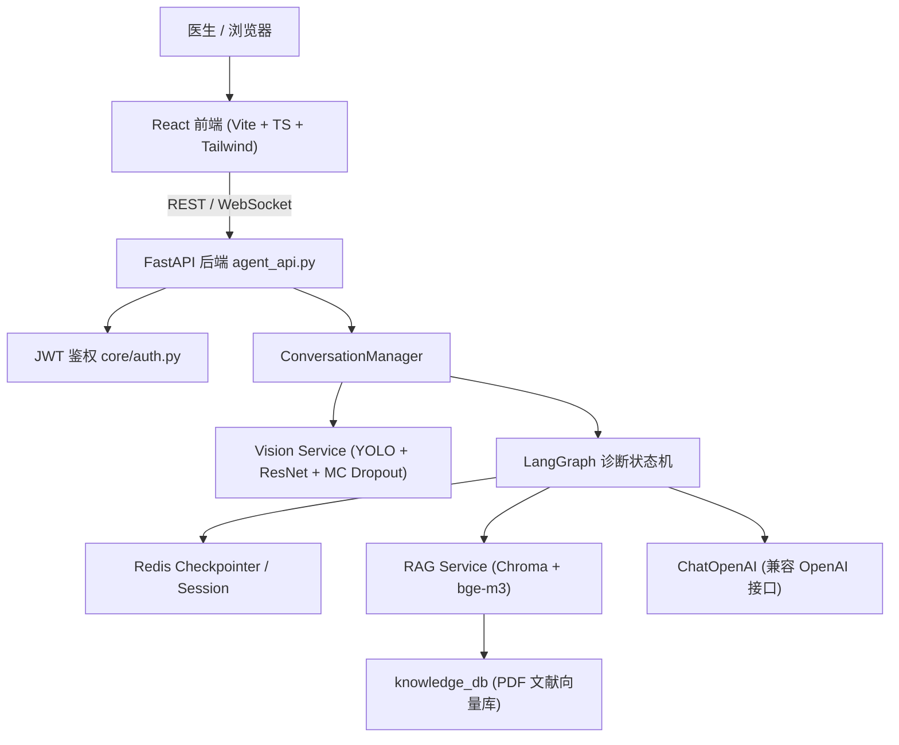
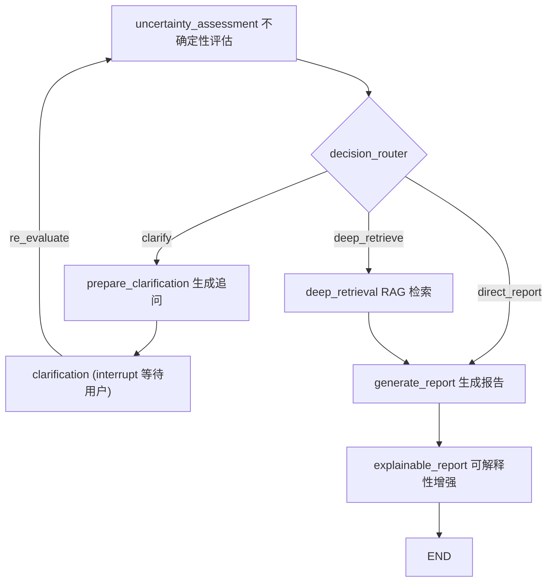

# Cervix-Cytology-AI-System · 宫颈细胞病理 AI 辅助诊断系统
一个面向病理医生的**多模态宫颈细胞学 AI 辅助诊断系统**。系统将 **计算机视觉（YOLO 检测 + ResNet 分类）**、**MC Dropout 不确定性估计**、**RAG 医学知识检索** 与 **LangGraph 智能体状态机** 相结合，自动完成从图像分析、不确定性评估、主动追问、知识检索到可解释诊断报告生成的全流程，并通过 **FastAPI + React** 提供完整的 Web 交互体验。
> ⚠️ **免责声明**：本项目仅用于科研与教学演示，输出结果为**辅助参考**，不能替代执业医师的专业诊断。

---

## 📋 项目概览

## ✨ 核心特性

- **双模型级联推理**：YOLO 检测细胞 → ResNet50 二分类筛查（normal/abnormal）→ 仅对异常细胞触发多分类细粒度分型（Sipakmed 5 类）。
- **不确定性感知决策**：基于 MC Dropout 多次前向传播估计预测方差，按阈值分级路由（直接报告 / 深度检索 / 主动追问）。
- **LangGraph 状态机 + 人在回路**：高不确定性时通过 `interrupt` 暂停图执行，等待医生补充信息后 `Command(resume=...)` 恢复。
- **RAG 知识增强**：Chroma 向量库 + `BAAI/bge-m3` 嵌入，对 `Cervical_cytology/` 下的 PDF 文献进行切分检索，为诊断提供医学依据与参考文献。
- **可解释性报告**：结合形态学特征（核质比、圆形度）、不确定性来源与文献引用，生成面向医生的诊断逻辑解释。
- **会话持久化**：Redis 作为 LangGraph Checkpointer 与会话存储，支持中断恢复与多轮追问。
- **生产级安全加固**：JWT 鉴权、CORS 白名单、接口限流、文件魔数/MIME 校验、医疗合规审计日志、上传目录自动清理。

---

## 🏗️ 系统架构



### 诊断状态机流程


---

## 📁 项目结构

```plaintext
Cervix-Cytology-AI-System/
├── agent_api.py # FastAPI 主服务（诊断/分析/登录/WebSocket）
├── Agents/ # LangGraph 智能体
│ ├── diagnosis_graph.py # 状态机节点与图构建、检查点/知识库初始化
│ ├── conversation.py # 会话管理器（诊断、澄清恢复、追问）
│ └── state.py # DiagnosisState 状态定义 (TypedDict)
├── services/
│ ├── vision_service.py # YOLO + ResNet 双模型推理 + MC Dropout + 形态学
│ └── rag_service.py # Chroma 向量知识库与检索
├── core/
│ ├── auth.py # JWT 生成/校验
│ └── redis_client.py # Redis 连接池（同步/异步）
├── models/ # 分类模型定义与训练脚本
├── Prompts/ # 提示词模板 (.md) 与临床内容常量
├── configs/ # 训练/模型 YAML 配置
├── scripts/ # 训练、评估、预测、蒸馏等脚本
├── tools/ # Grad-CAM、形态学工具
├── utils/ # 数据加载、增强、预处理、可视化
├── appWeb/ # Flask 传统 Web 后端 + 医生账号数据
├── frontend/ # React + TypeScript + Vite 前端
├── Cervical_cytology/ # 医学文献 PDF（RAG 数据源）
├── knowledge_db/ # Chroma 持久化向量库
├── data/ # Herlev / Sipakmed 数据集
├── runs/, outputs/ # 训练产物、模型权重、评估结果
└── tests/ # pytest 单元与接口测试
```

---

## 🛠️ 技术栈

| 层级 | 技术 |
| --- | --- |
| **后端服务** | FastAPI, Uvicorn, WebSocket, slowapi (限流), Flask (传统 Web) |
| **智能体编排** | LangChain, LangGraph, langgraph-checkpoint-redis |
| **计算机视觉** | PyTorch 2.6, torchvision, Ultralytics YOLO, OpenCV |
| **RAG / 嵌入** | Chroma, sentence-transformers, transformers (`BAAI/bge-m3`), pypdf |
| **大模型** | ChatOpenAI（兼容 OpenAI 接口） |
| **存储** | Redis（会话 + LangGraph Checkpointer） |
| **前端** | React 18, TypeScript, Vite, TailwindCSS, React Router, Axios, lucide-react |
| **鉴权/安全** | python-jose (JWT), Werkzeug (密码哈希/安全文件名) |
| **测试/追踪** | pytest, pytest-asyncio, httpx, wandb, tensorboard |

---

## 🚀 快速开始

### 1. 环境要求

- Python 3.11（推荐 3.10+）
- Node.js 18+
- **Redis Stack**（含 RediSearch 与 RedisJSON 模块）
  LangGraph 的 Redis Checkpointer 需要 `FT.*` / `JSON.*` 命令，普通 Redis 无法满足：
```bash
  docker run -d --name redis-stack -p 6379:6379 redis/redis-stack-server:latest
  ```
  应用启动时（`lifespan`）会自动：加载 CV 模型 → 检查/构建 RAG 知识库（语料未变则跳过，见 `knowledge_db/kb_manifest.json`）→ 初始化 Redis 检查点 → 启动上传目录清理任务。任一外部依赖（RAG / Redis）失败只会降级对应功能，不会阻断服务启动。
- （可选）NVIDIA GPU 与 CUDA，用于加速推理与训练

### 2. 安装依赖

```bash
Python 依赖
pip install -r requirements.txt
前端依赖
cd frontend 
npm install
```

### 3. 配置环境变量

```bash
复制 `.env.example` 为 `.env` 并按需填写：
dotenv

LLM 配置
OPENAI_API_KEY=your_api_key_here 
LLM_MODEL_ID=Qwen/Qwen3-VL-8B-Instruct
LLM_BASE_URL=https://api-inference.modelscope.cn/v1

模型权重路径
YOLO_WEIGHTS=runs/detect/cervical_cell_exp4/weights/best.pt
BINARY_WEIGHTS=outputs/models/best_resnet50_binary_model.pth
MULTI_WEIGHTS=outputs/models/best_resnet50_multiclass_sipakmed_model.pth

安全 / 服务配置
JWT_SECRET_KEY=<强随机密钥，必填>
REDIS_URL=redis://localhost:6379/0
CORS_ORIGINS=http://localhost:3000

不确定性阈值
UNCERTAINTY_HIGH=0.60
UNCERTAINTY_MEDIUM=0.30

Flask 传统 Web（可选）
FLASK_SECRET_KEY=your_secret_key_here
FLASK_DEBUG=false
> 🔒 `JWT_SECRET_KEY` **必须设置为强随机值**，否则 `core/auth.py` 在启动时会抛出 `RuntimeError` 拒绝启动。
```

### 4. 启动服务

```bash
启动 FastAPI 主服务（默认 http://0.0.0.0:8000）
python agent_api.py

或直接使用 uvicorn
uvicorn agent_api:app --host 0.0.0.0 --port 8000 --reload

启动 React 前端（另开终端）
cd frontend
npm run dev

（可选）启动 Flask 传统 Web 后端（http://127.0.0.1:5001）
python appWeb/app.py
```

应用启动时（`lifespan`）会自动：加载 CV 模型 → 构建/加载 RAG 知识库 → 初始化 Redis 检查点 → 启动上传目录清理任务。

---

## 🔌 API 接口

所有 `/api/*` 与 `/analyze*` 接口均需 `Authorization: Bearer <JWT>` 头；WebSocket 通过`Sec-WebSocket-Protocol: bearer, <JWT>` 子协议头传递（不再使用 `?token=`）。

| 方法 | 路径 | 说明 | 限流 |
| --- | --- | --- | --- |
| POST | `/api/auth/login` | 医生登录，返回 JWT | - |
| POST | `/api/agent/upload` | 上传单张图片并启动完整诊断流程 | 10/min |
| POST | `/api/agent/clarify/{session_id}` | 回答澄清问题，恢复中断的诊断 | 20/min |
| POST | `/api/agent/followup` | 诊断完成后的自由追问 | 20/min |
| WS | `/ws/agent/chat/{session_id}` | 追问对话的流式 WebSocket 通道 | - |
| POST | `/analyze` | 单张图片双模型分析 | 10/min |
| POST | `/analyze_batch` | 多张图片批量分析（≤10 张） | 5/min |
| POST | `/analyze_zip` | ZIP 压缩包批量分析（≤20 张） | 3/min |
| GET | `/health` | 健康检查（设备、模型、阈值配置） | - |

### `/analyze*` 与 Agent 诊断的能力边界

| | `/analyze`、`/analyze_batch`、`/analyze_zip` | `/api/agent/upload` 及后续 |
|---|---|---|
| 是否走 LangGraph | ❌ 直接返回 CVResult | ✅ 完整状态机 |
| 追问澄清 | ❌ | ✅ |
| RAG 医学依据 | ❌ | ✅ |
| 可解释性报告 | ❌ | ✅ |
| 风险口径 | 仅 `risk_level`（`risk_scope` 同步返回） | 含 `risk_scope` + `decision_reason` + 建议 |
| 用途 | **快速筛查 / 批量预筛** | **可追溯的辅助诊断记录** |

⚠️ 快速分析页的输出**不构成诊断记录**，不应作为临床决策依据，也不写入审计留痕。

### 示例：登录 + 诊断

```bash
登录获取 token
curl -X POST http://localhost:8000/api/auth/login
-H "Content-Type: application/json"
-d '{"username":"doctor","password":"your_password"}'

上传图片开始诊断
curl -X POST http://localhost:8000/api/agent/upload
-H "Authorization: Bearer <TOKEN>"
-F "file=@/path/to/cell_image.png"
```

---

## 🧠 模型与训练

### 视觉流水线

1. **YOLO 检测**：定位图像中所有细胞框（`conf=0.25`, `iou=0.45`）。
2. **二分类筛查**：ResNet50 判定 normal/abnormal（异常需 `conf ≥ 0.5`）。
3. **多分类分型**：对异常细胞细分为 `Dyskeratotic / Koilocytotic / Metaplastic / Parabasal / SuperficialIntermediate`。
4. **MC Dropout**：对当前活跃模型做多次采样（默认 10 次），取预测标准差最大值作为不确定性。
5. **形态学分析**：计算核质比、圆形度、面积、周长并给出解读。

分类模型（`models/cer_cancer_model.py`）支持 `resnet50 / resnet101 / efficientnet_b0` 主干，可选 **SE** 或 **CBAM** 注意力机制。

## 模型性能（病例级分组划分，可引用）

| 任务 | 指标 | 说明 |
|---|---|---|
| 检测（YOLOv8n） | mAP50 **0.986** | SIPaKMeD 单细胞裁剪图；真实视野未验证 |
| 二分类 | acc **94.59%** / AUC 0.980 | SIPaKMeD + Herlev，1504 病例 |
| 多分类 SIPaKMeD | acc **92.93%** / macro F1 0.921 | 966 病例，0 泄漏 |
| 多分类 Herlev | acc **71.14%** | 538 病例；CIN2/CIN3 边界为主要误差源 |

### 训练命令

```bash
YOLO 检测模型训练
python scripts/train_yolo.py --data configs/sipakmed_yolo.yaml --model yolov8n.pt --epochs 100 --batch 16 --imgsz 640 --name cervical_cell_exp

分类模型训练（基于 configs/*.yaml）
python models/train.py --config configs/default.yaml

评估 / 预测（已注册为命令行入口）
cervical-evaluate
cervical-predict
python scripts/evaluate_detection.py # 检测评估
python scripts/cross_validation.py # 交叉验证
python scripts/model_distillation.py # 模型蒸馏
python scripts/ensemble_predict.py # 集成预测
训练相关参数（数据集、批大小、增强、损失函数、优化器等）见 `configs/` 目录下的 YAML 配置。
```

---

## 🧪 测试

```bash
pytest # 运行全部测试
pytest tests/test_api.py # 接口测试
pytest tests/test_unit.py # 单元测试
pytest tests/test_clarify.py # 澄清流程测试
```
> 配置见 `pytest.ini`；已禁用 `faulthandler` 以屏蔽 Windows 下的良性 AV 噪声。

---

## 🔐 安全与合规

- **认证**：JWT（HS256，默认有效期 1 小时），医生账号存于 `appWeb/doctor_accounts.json`（密码使用 Werkzeug 哈希）。
- **CORS**：仅允许 `CORS_ORIGINS` 白名单来源。
- **限流**：slowapi 按客户端 IP 对各接口分别限流。
- **文件校验**：扩展名白名单 + MIME 类型匹配 + 魔数（Magic Bytes）校验 + PIL 完整性验证；单文件上限 30MB，ZIP 解压上限 200MB。
- **路径安全**：`secure_filename` + 上传路径逃逸检查。
- **审计日志**：记录 IP、方法、路径、状态码与延迟，满足医疗合规追溯需求。
- **资源回收**：后台任务定期清理 `uploads/` 中超期文件（默认 6 小时）。

---

## 📊 数据集

- **Sipakmed**：宫颈细胞五分类数据集（`data/sipakmed`、`data/sipakmed_yolo`）。
- **Herlev**：宫颈细胞分级数据集（`data/herlev`，含 light/moderate dysplastic、carcinoma in situ 等）。

---

## 📝 许可

本项目基于 MIT License 开源（详见 `setup.py`）。

## 🔗 仓库

GitHub: https://github.com/Xsxweri/cervical-ai-diagnosis