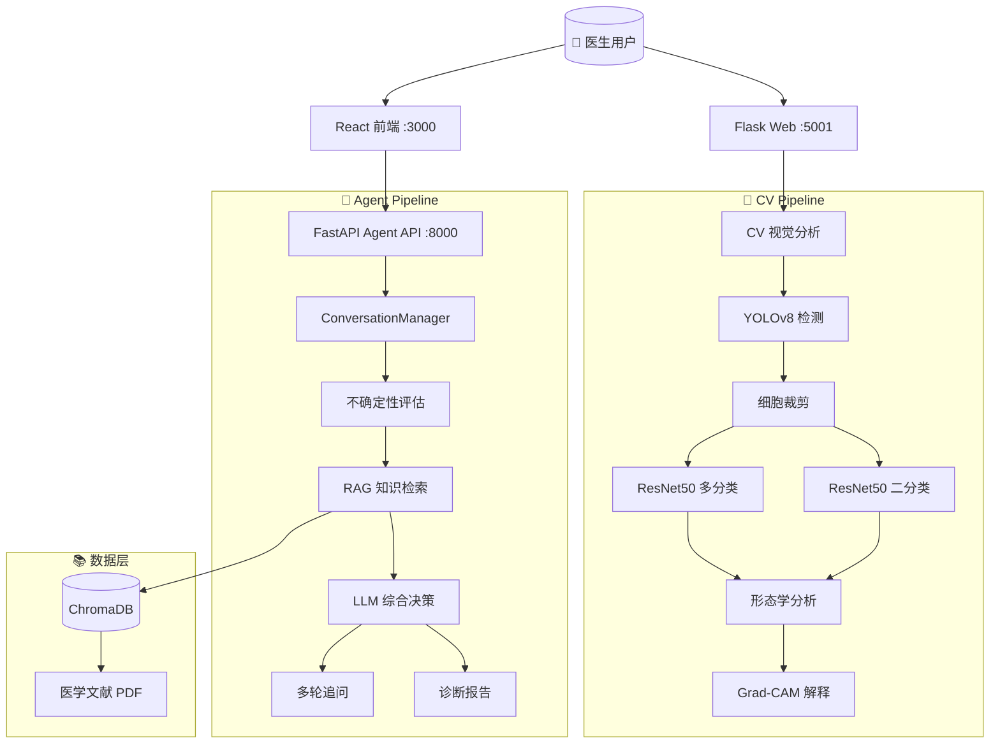

# 🏥 宫颈细胞病理 AI 辅助诊断系统 (v2.0)

> **基于深度学习 + 大语言模型的多模态宫颈细胞病理智能辅助诊断平台**

---

## 📋 项目概览

本项目是一个面向宫颈细胞病理学的 **AI 辅助诊断系统**，融合了**计算机视觉 (CV)** 与**大语言模型 (LLM)** 能力。系统通过 **YOLO 目标检测 + ResNet50 分类** 双模型协同架构实现细胞的自动定位与病变分级，并借助 **LangGraph Agent** 构建了完整的 AI 诊断推理流程，支持不确定性量化、RAG 医学知识检索、多轮对话追问、Grad-CAM 可解释性分析等高级功能。

> 🔄 **v1.x → v2.0 升级**: 从纯 CV 分类系统进化为 **CV + LLM Agent 协同诊断系统**，新增 LangGraph 工作流、RAG 知识库、WebSocket 实时通信和 React 现代前端。

---

## 🌟 核心功能

### 🧠 视觉分析 (CV Pipeline)
| 功能 | 说明 |
|------|------|
| **细胞检测** | YOLOv8n/YOLO11n 精确定位图像中的单个宫颈细胞 |
| **二分类** | ResNet50 判断细胞正常/异常 (Binary) |
| **多分类** | ResNet50 进行 5 类 SIPaKMeD 细粒度分型 |
| **注意力机制** | 集成 SE-Block / CBAM 提升关键特征提取能力 |
| **MC Dropout** | 蒙特卡洛 Dropout 不确定性估计，量化模型置信度 |
| **形态学分析** | 核质比、面积、周长、圆形度等细胞形态特征提取 |
| **Grad-CAM** | 热力图可视化模型决策依据，辅助医生理解 AI 判断 |

### 🤖 AI Agent 诊断推理 (Agent Pipeline)
| 功能 | 说明 |
|------|------|
| **LangGraph 工作流** | 状态机驱动的多步诊断流程：不确定性评估 → 知识检索 → 综合决策 |
| **RAG 知识库** | 基于 ChromaDB + BGE-M3 嵌入的医学文献检索增强生成 |
| **多轮对话** | 支持诊断完成后对结果的持续性追问与答疑 |
| **澄清追问** | 高不确定性时主动生成追问问题，收集更多临床信息 |
| **可解释报告** | 结合 Grad-CAM + 形态学分析，生成带依据的结构化诊断报告 |

### 🖥️ 双前端界面
| 系统 | 技术栈 | 端口 | 说明 |
|------|--------|------|------|
| **Flask Web** | Flask + Jinja2 | `5001` | 医生快速诊断面板，轻量级传统界面 |
| **React 前端** | React 18 + TypeScript + Vite + Tailwind CSS | `3000` | 现代 SPA，对接 Agent API |
| **FastAPI 后端** | FastAPI + Uvicorn | `8000` | Agent API 主服务，支持 REST + WebSocket |

---

## 🏗️ 系统架构



---

## 📊 数据集

| 数据集 | 图像数量 | 原始类别 | 使用方式 |
|--------|---------|---------|---------|
| **HERLEV** | 917 张 | 7 类 (TBS 分级) | 分类训练/评估 |
| **SIPaKMeD** | 5,015 张 | 5 类 | 分类训练/评估 |
| **SIPaKMeD-YOLO** | 5,015 张 | YOLO 标注格式 | 检测训练 |
| **合计** | **~6,000 张** | **7→2 类 (二分类)** | - |

> **数据划分**: 训练集 70% / 验证集 15% / 测试集 15%

---

## 🛠️ 技术栈

### 核心框架
| 类别 | 技术 |
|------|------|
| **深度学习** | PyTorch ≥1.9.0, TorchVision |
| **目标检测** | Ultralytics YOLOv8 / YOLO11 |
| **LLM Agent** | LangChain, LangGraph, LangChain-OpenAI |
| **RAG 向量库** | ChromaDB, HuggingFace Embeddings (BGE-M3) |
| **后端服务** | FastAPI, Uvicorn, WebSockets |
| **传统后端** | Flask 2.3.2 |
| **现代前端** | React 18, TypeScript, Vite, Tailwind CSS |
| **图像处理** | OpenCV ≥4.5.0, Pillow |
| **数据科学** | NumPy, scikit-learn, Matplotlib, TensorBoard, WandB |

---

## 📦 安装与配置

### 1. 环境准备

```bash
conda create -n cervical-ai python=3.10
conda activate cervical-ai
```

### 2. 安装依赖

```bash
pip install -r requirements.txt
```

### 3. 数据集准备

将数据集放入对应目录：

```
data/
├── herlev/          # HERLEV 原始数据 (7 类子目录)
│   ├── carcinoma_in_situ/
│   ├── light_dysplastic/
│   ├── moderate_dysplastic/
│   ├── normal_columnar/
│   ├── normal_intermediate/
│   ├── normal_superficial/
│   └── severe_dysplastic/
└── sipakmed/        # SIPaKMeD 原始数据 (5 类子目录)
    ├── im_Dyskeratotic/
    ├── im_Koilocytotic/
    ├── im_Metaplastic/
    ├── im_Parabasal/
    └── im_Superficial-Intermediate/
```

### 4. LLM 配置 (Agent 功能必需)

在项目根目录创建 `.env` 文件：

```env
# LLM 配置 (支持 OpenAI / 任意兼容接口)
OPENAI_API_KEY=your_api_key_here
LLM_BASE_URL=https://api.openai.com/v1
LLM_MODEL_ID=gpt-4o-mini

# 服务配置
CORS_ORIGINS=http://localhost:3000
```

### 5. 前端依赖 (可选)

```bash
cd frontend
npm install
```

---

## 🚀 快速开始

### 🔬 训练视觉模型

#### 分类模型训练

```bash
# 二分类模式 (默认)
python scripts/train.py --config configs/default.yaml --epochs 100

# 多分类模式 (5 类 / 7 类)
python scripts/train.py --classification_mode multiclass --epochs 150

# 使用 Focal Loss + EMA
python scripts/train.py --loss_type focal --use_ema --experiment_name exp_focal_ema

# 使用注意力机制 (CBAM)
python scripts/train.py --attention_type cbam --model_type resnet101

# EfficientNet 骨干网络
python scripts/train.py --config configs/efficientnet_config.yaml
```

#### YOLO 检测模型训练

```bash
python scripts/train_yolo.py \
  --data configs/sipakmed_yolo.yaml \
  --epochs 100 --batch 16 --imgsz 640
```

#### 交叉验证

```bash
python scripts/cross_validation.py --folds 5
```

### 📊 评估模型

```bash
# 基础评估
python scripts/evaluate.py --model_path outputs/models/best_resnet50_binary_model.pth

# 绘制 ROC 曲线
python scripts/evaluate.py --model_path outputs/models/best_model.pth --plot_roc

# MC Dropout 不确定性估计
python scripts/evaluate.py --model_path outputs/models/best_model.pth --use_mc_dropout --mc_samples 20

# 检测模型评估
python scripts/evaluate_detection.py

# 多中心评估
python scripts/multicenter_evaluation.py
```

### 🧪 模型优化

```bash
# 模型量化 (减小体积 加速推理)
python scripts/optimize_model.py --model_path outputs/models/best_resnet50_binary_model.pth

# 知识蒸馏 (大模型教小模型)
python scripts/model_distillation.py \
  --teacher_model resnet101 \
  --student_model resnet50

# 集成预测 (多模型投票/平均)
python scripts/ensemble_predict.py \
  --models model1.pth model2.pth model3.pth
```

### 🖥️ 启动服务

#### 方式 A: 传统 Flask Web 界面 (单张/批量诊断)

```bash
cd appWeb
python app.py
# 访问 http://localhost:5001
```

**测试账号**:

| 用户名 | 密码 | 姓名 | 科室 |
|--------|------|------|------|
| `dr_zhang` | `password123` | 张医生 | 妇科 |
| `dr_wang` | `securepwd456` | 王医生 | 病理科 |
| `dr_li` | `secret789` | 李医生 | 妇科 |

#### 方式 B: FastAPI Agent 服务 + React 前端 (推荐)

**启动后端 Agent API：**

```bash
# 方式一：直接运行
python agent_api.py

# 方式二：使用 uvicorn (热重载)
uvicorn agent_api:app --host 0.0.0.0 --port 8000 --reload

# 访问 http://localhost:8000/docs (Swagger 文档)
```

**启动 React 前端：**

```bash
cd frontend
npm run dev
# 访问 http://localhost:5173
```

#### API 接口一览

| 方法 | 路径 | 说明 |
|------|------|------|
| `POST` | `/analyze` | 单张图片双模型分析 |
| `POST` | `/analyze_batch` | 多张图片批量分析 |
| `POST` | `/analyze_zip` | ZIP 压缩包批量分析 |
| `POST` | `/chat` | Agent 诊断对话 |
| `POST` | `/followup` | 诊断完成后追问 |
| `WebSocket` | `/ws/{session_id}` | 实时进度推送 |

---

## 📁 项目结构

```
Cervix-Cytology-AI-System/
│
├── agent_api.py                  # FastAPI 主服务 (Agent API v2.0)
├── setup.py                      # 项目安装脚本
├── requirements.txt              # Python 依赖清单
│
├── Agents/                       # AI Agent 模块
│   ├── conversation.py           # 多轮对话管理器
│   ├── diagnosis_graph.py        #   LangGraph 诊断工作流
│   └── state.py                  # 状态机数据结构定义
│
├── services/                     # 核心服务层
│   ├── vision_service.py         # CV 视觉分析服务 (YOLO + ResNet + MC Dropout)
│   └── rag_service.py            # RAG 医学知识检索服务
│
├── models/                       # 深度学习模型定义
│   ├── cer_cancer_model.py       # 分类模型 (ResNet/EfficientNet + SE/CBAM)
│   ├── resnet_model.py           # ResNet 变体封装
│   ├── yolo_model.py             # YOLO 检测模型封装
│   └── train.py                  # 模型训练逻辑
│
├── tools/                        #  LangGraph Agent 工具
│   ├── gradcam_tool.py           #   Grad-CAM 可解释性分析工具
│   └── morphology_tool.py        # 细胞形态学分析工具
│
├── utils/                        # 工具函数库
│   ├── data_loader.py            # 数据加载器
│   ├── preprocess.py             # 预处理与增强
│   ├── advanced_augmentation.py  # MixUp/CutMix 高级增强
│   ├── cell_analyzer.py          # 细胞形态学分析器
│   ├── grad_cam.py               #   Grad-CAM 实现
│   ├── visualization.py          # 可视化工具
│   ├── wsi_processor.py          # 全切片 (WSI) 分块处理器
│   └── yolo_processor.py         # YOLO 数据格式处理器
│
├── scripts/                      # 训练/评估/工具脚本
│   ├── train.py                  # 分类模型训练
│   ├── train_yolo.py             # YOLO 检测模型训练
│   ├── evaluate.py               # 分类模型评估
│   ├── evaluate_detection.py     # 检测模型评估
│   ├── predict.py                # 单张图像预测
│   ├── realtime_predict.py       # 实时预测 (优化推理速度)
│   ├── cross_validation.py       # K 折交叉验证
│   ├── ensemble_predict.py       # 模型集成预测
│   ├── model_distillation.py     # 知识蒸馏
│   ├── optimize_model.py         # 模型量化优化
│   └── multicenter_evaluation.py # 多中心泛化评估
│
├── configs/                      # 配置文件
│   ├── default.yaml              # 默认训练配置
│   ├── efficientnet_config.yaml  #   EfficientNet 配置
│   ├── resnet101_cbam_config.yaml#   ResNet101 + CBAM 配置
│   ├── sipakmed_classifier.yaml  #   SIPaKMeD 分类配置
│   ├── sipakmed_yolo.yaml        #   SIPaKMeD YOLO 配置
│   ├── vit_config.yaml           # Vision Transformer 配置
│   └── herlev_classifier.yaml    # HERLEV 分类配置
│
├── appWeb/                       # Flask 传统 Web 界面
│   ├── app.py                    # Flask 主程序
│   ├── doctor_accounts.json      # 医生账号存储
│   └── templates/
│       └── tryweb.html           # 前端模板
│
├── frontend/                     # React 现代前端
│   ├── package.json              # 前端依赖
│   ├── vite.config.ts            # Vite 构建配置
│   ├── tailwind.config.js        #   Tailwind CSS 配置
│   ├── tsconfig.json             #   TypeScript 配置
│   └── src/
│       ├── App.tsx               # 主组件
│       ├── components/           # 组件库
│       └── assets/               # 静态资源
│
├── data/                         # 数据集
│   ├── herlev/                   # HERLEV (7 类)
│   └── sipakmed/                 #   SIPaKMeD (5 类 + YOLO 标签)
│
├── outputs/                      # 训练输出
│   ├── models/                   # 模型权重
│   ├── results/                  # 评估结果
│   └── logs/                     #   TensorBoard 日志
│
└── runs/                         # YOLO 训练输出
    └── detect/                   # YOLO 检测结果
```

---

## ⚙️ 配置说明

编辑 `configs/default.yaml` 修改训练参数：

```yaml
data:
  batch_size: 32
  img_size: 224
  train_ratio: 0.7
  val_ratio: 0.15
  test_ratio: 0.15

model:
  name: "resnet50"
  num_classes: 7
  pretrained: true
  dropout_rate: 0.5
  use_attention: false

training:
  epochs: 100
  learning_rate: 0.001
  weight_decay: 0.0001
  early_stopping_patience: 15
  loss_type: "cross_entropy"   # cross_entropy / focal / weighted
  use_ema: false
```

支持的其他配置模板：

| 配置文件 | 适用场景 |
|---------|---------|
| `default.yaml` | ResNet50 基础训练 |
| `efficientnet_config.yaml` | EfficientNet 轻量骨干 |
| `resnet101_cbam_config.yaml` | ResNet101 + CBAM 注意力 |
| `vit_config.yaml` | Vision Transformer |
| `sipakmed_classifier.yaml` | SIPaKMeD 5 类分型 |
| `herlev_classifier.yaml` | HERLEV 7 类 TBS 分级 |
| `sipakmed_yolo.yaml` | YOLO 检测训练 |

---

## 📈 性能指标

### 二分类 (正常/异常)

| 指标 | 典型范围 |
|------|---------|
| **准确率 (Accuracy)** | 92% – 95% |
| **精确率 (Precision)** | 90% – 93% |
| **召回率 (Recall)** | 91% – 94% |
| **F1-Score** | 90% – 93% |
| **AUC** | 0.95 – 0.97 |

### 多分类 (5 类 SIPaKMeD)

| 类别 | 精确率 | 召回率 |
|------|--------|--------|
| Dyskeratotic | 85-90% | 82-88% |
| Koilocytotic | 88-93% | 85-90% |
| Metaplastic | 90-94% | 88-92% |
| Parabasal | 87-92% | 85-89% |
| Superficial-Intermediate | 92-96% | 90-94% |

---

## 🔧 高级功能详解

### 1. AI Agent 诊断流程

```
用户上传图像 → YOLO 检测细胞 → ResNet 分类
    → MC Dropout 不确定性评估
        ├── 低不确定性 → RAG 检索 → LLM 综合诊断 → 输出报告
        └── 高不确定性 → 追问用户获取更多信息 → 结合 CV 结果再诊断
```

### 2. RAG 医学知识库

```python
# 加载医学文献 PDF 到知识库
from services.rag_service import MedicalKnowledgeBase

kb = MedicalKnowledgeBase(persist_dir="./knowledge_db")
kb.load_documents(["path/to/medical_literature.pdf"])
```

### 3. Grad-CAM 可视化

```python
from tools.gradcam_tool import GradCAMTool

explainer = GradCAMTool(model, target_layer="layer4")
heatmap_path, analysis = explainer.generate(
    image=cell_image,
    target_class=class_idx
)
# 返回热力图路径 + AI 对注意力区域的解读
```

### 4. WSI 全切片处理

```python
from utils.wsi_processor import WSIProcessor

processor = WSIProcessor(patch_size=1024, overlap=128)
patches = processor.split_image(large_wsi_image)
results = processor.process_patches(patches, model)
```

### 5. 实时预测

```bash
python scripts/realtime_predict.py \
  --model_path outputs/models/best_resnet50_binary_model.pth \
  --source 0                      # 摄像头 ID 或视频路径
```

---

## 🔬 项目路线图

- [x] YOLOv8 细胞检测
- [x] ResNet50 二分类/多分类
- [x] SE/CBAM 注意力机制
- [x] MixUp/CutMix 高级增强
- [x] MC Dropout 不确定性估计
- [x] Flask Web 界面
- [x] FastAPI + LangGraph Agent 架构
- [x] RAG 医学知识库
- [x] Grad-CAM 可解释性
- [x] 形态学分析工具
- [x] React 现代前端
- [x] WebSocket 实时进度推送
- [ ] 多模态融合 (细胞学 + 临床文本)
- [ ] 联邦学习多中心协同
- [ ] 病理报告自动生成
- [ ] 移动端适配

---

## 📄 许可证

本项目基于 MIT 许可证开源。

---

## 👥 贡献 & 📞 联系方式

欢迎提交 Issue 和 Pull Request 参与项目贡献。

- 项目地址: [https://github.com/Xsxweri/cervical-ai-diagnosis](https://github.com/Xsxweri/cervical-ai-diagnosis)