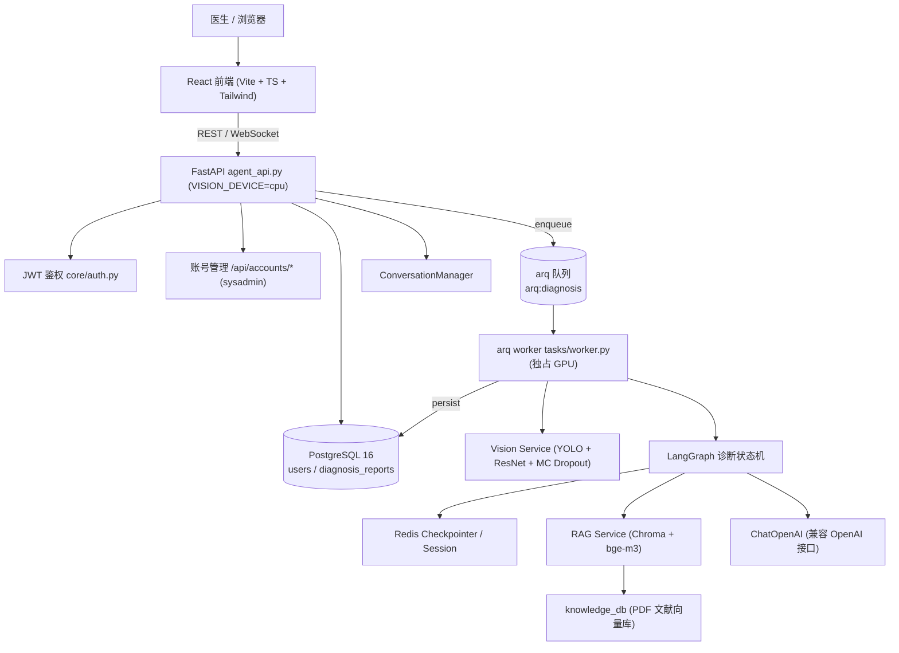
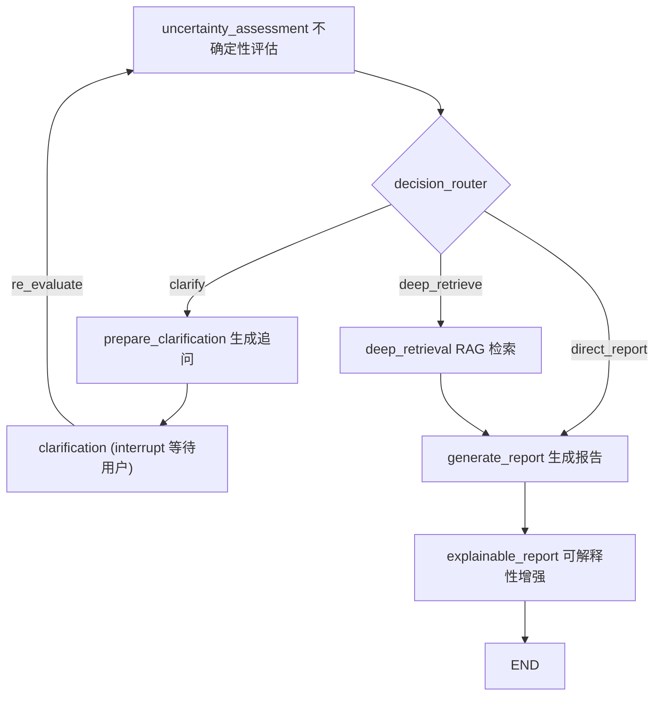

# Cervix-Cytology-AI-System · 宫颈细胞病理 AI 辅助诊断系统
一个面向病理医生的**多模态宫颈细胞学 AI 辅助诊断系统**。系统将 **计算机视觉（YOLO 检测 + ResNet 分类）**、**不确定性估计**、**RAG 医学知识检索** 与 **LangGraph 智能体状态机** 相结合，自动完成从图像分析、不确定性评估、主动追问、知识检索到可解释诊断报告生成的全流程，并通过 **FastAPI + React** 提供完整的 Web 交互体验。
> ⚠️ **免责声明**：本项目仅用于科研与教学演示，输出结果为**辅助参考**，不能替代执业医师的专业诊断。

---

## 📋 项目概览

## ✨ 核心特性

- **双模型级联推理**：YOLO 检测细胞 → ResNet50 二分类筛查（normal/abnormal）→ 仅对异常细胞触发多分类细粒度分型（支持 SIPaKMeD 5 类形态分型 / Herlev 7 级病理分级 / dual 双空间一致性校验）。
- **标签空间可切换**：`MULTI_LABEL_SPACE` 三选一 —— `sipakmed`（形态分型，精度 ~93%）、`herlev`（CIN 1/2/3 分级，精度 ~71%）、`dual`（双跑 + 单向一致性校验，冲突转人工复核）。权重与标签空间由 sidecar `.classes.json` 双向校验，错配直接拒绝加载。
- **结论冲突检测**：二分类判异常而分级模型归为非异常类时标记 `review_required`，报告显式提示人工镜检复核，且冲突细胞**仍计入异常计数**（避免因剔除而低估风险）。
- **不确定性感知决策**：基于 MC Dropout 多次前向传播估计预测方差，按阈值分级路由（直接报告 / 深度检索 / 主动追问）。
- **LangGraph 状态机 + 人在回路**：高不确定性时通过 `interrupt` 暂停图执行，等待医生补充信息后 `Command(resume=...)` 恢复。
- **RAG 知识增强**：Chroma 向量库 + `BAAI/bge-m3` 嵌入，对 `Cervical_cytology/` 下的 PDF 文献进行切分检索，为诊断提供医学依据与参考文献。
- **可解释性报告**：结合形态学特征（核质比、圆形度）、不确定性来源与文献引用，生成面向医生的诊断逻辑解释。
- **会话与报告分离存储**：Redis 存进行中会话（TTL 1 天）+ LangGraph Checkpointer；PostgreSQL 存账号与已完成报告（永久），Redis 过期后自动回填，不会 404。
- **长任务队列**：`/api/agent/upload` 经 **arq**（Redis 队列）异步执行，返回 `202 + session_id`，前端轮询 `/api/agent/task/{id}`，规避 120s 超时。
- **角色分权**：`doctor`（诊断）/ `admin`（业务占位）/ `sysadmin`（账号管理，仅运维用 SQL 授予），管理接口每次回查 DB 而非信任 JWT claim。
- **生产级安全加固**：JWT 鉴权、CORS 白名单、接口限流、文件魔数/MIME 校验、医疗合规审计日志、上传目录自动清理。

---

## 🏗️ 系统架构



### 诊断状态机流程


---

## 📁 项目结构

```plaintext
Cervix-Cytology-AI-System/
├── agent_api.py # FastAPI 入口（app 装配 + 门面）
├── api/ # HTTP 层
│ ├── config.py # 常量、白名单、资源上限
│ ├── schemas.py # 请求/响应模型
│ ├── security.py # 鉴权辅助、require_sysadmin、上传校验
│ ├── logging_setup.py # root + 独立审计日志
│ ├── runtime.py # 限流器、WS 连接池、arq 连接池、DI 工厂
│ ├── uploads.py # 上传目录 TTL 清理
│ ├── middleware.py # 审计 + CORS（顺序敏感）
│ ├── lifespan.py # DB / 模型 / RAG / checkpointer / 队列预热
│ └── routes/ # auth / accounts / vision / agent 四个 APIRouter
│ ├── diagnosis_graph.py # 图装配 get_builder() + 兼容门面
│ ├── routing.py # decision_router / explainable_router
│ ├── checkpoint.py # checkpointer 生命周期 + 编译图单例
│ ├── knowledge.py # 知识库生命周期（失败降级）
│ ├── llm.py # LLM 工厂 + 结构化输出模型
│ ├── nodes/ # 9 个图节点，按职责分模块
│ │ ├── uncertainty.py # 不确定性评估（含 _decision 构造器）
│ │ ├── clarification.py # 追问生成 + interrupt 恢复
│ │ ├── retrieval.py # RAG 检索 + 检索后重评
│ │ ├── report.py # 报告生成 / 不可判读 / 无 LLM 摘要
│ │ └── explainability.py # 可解释性报告
│ ├── conversation.py # 会话编排
│ ├── session_store.py # 序列化 + Redis 读写 + 归属校验
│ ├── followup_prompt.py # 追问 Prompt 构造（纯函数）
│ └── state.py # DiagnosisState 状态定义 (TypedDict)
├── services/
│ ├── vision_service.py # YOLO + ResNet 双模型推理 + MC Dropout + 形态学
│ └── rag_service.py # Chroma 向量知识库与检索
├── core/
│ ├── auth.py # JWT 生成/校验
│ ├── db.py # asyncpg 连接池 + jsonb 编解码
│ ├── env.py # 统一 .env 加载（项目根定位）
│ ├── task_store.py # 任务状态（Redis）+ worker 心跳键
│ └── redis_client.py # Redis 连接池（同步/异步）
├── repos/ # 数据访问层
│ ├── user_repo.py # 账号 CRUD / 登录失败计数 / 锁定
│ └── report_repo.py # 已完成报告持久化（cells 精简白名单）
├── tasks/ # arq worker（独立进程）
│ ├── jobs.py # run_diagnosis 任务
│ └── worker.py # WorkerSettings（max_jobs=1、心跳 cron）
├── docker/
│ ├── initdb/ # 01_schema.sql / 02_sysadmin.sql
│ └── scripts/ # pg_archive.py、cleanup_runtime.py（默认 dry-run）
├── docker-compose.yml # PostgreSQL 编排（Redis 由宿主机提供）
├── models/ # 分类模型定义与训练脚本
├── Prompts/ # 提示词模板 (.md) 与临床内容常量
├── configs/ # 训练/模型 YAML 配置
├── scripts/ # 训练、评估、预测、蒸馏等脚本
├── tools/ # Grad-CAM、形态学工具
├── utils/ # 数据加载、增强、预处理、可视化
├── frontend/ # React + TypeScript + Vite 前端
├── Cervical_cytology/ # 医学文献 PDF（RAG 数据源）
├── knowledge_db/ # Chroma 持久化向量库
├── data/ # Herlev / Sipakmed 数据集
├── runs/, outputs/ # 训练产物、模型权重、评估结果
└── tests/ # pytest 单元与接口测试
```

---

## 🛠️ 技术栈

| 层级 | 技术 |
| --- | --- |
| **后端服务** | FastAPI, Uvicorn, WebSocket, slowapi (限流), **arq** (异步任务队列) |
| **智能体编排** | LangChain, LangGraph, langgraph-checkpoint-redis |
| **计算机视觉** | PyTorch 2.6, torchvision, Ultralytics YOLO, OpenCV |
| **RAG / 嵌入** | Chroma, sentence-transformers, transformers (`BAAI/bge-m3`), pypdf |
| **大模型** | ChatOpenAI（兼容 OpenAI 接口） |
| **存储** | Redis Stack（会话 + Checkpointer + 队列）, PostgreSQL 16（账号、已完成报告）|
| **前端** | React 18, TypeScript, Vite, TailwindCSS, React Router, Axios, lucide-react |
| **鉴权/安全** | python-jose (JWT), Werkzeug (密码哈希/安全文件名) |
| **测试/追踪** | pytest, pytest-asyncio, httpx, wandb, tensorboard |

---

## 🚀 快速开始

### 1. 环境要求

- Python 3.11（推荐 3.10+）
- Node.js 18+
- **PostgreSQL 16（必需）**
  账号与已完成报告的唯一持久化存储。未就绪时服务**拒绝启动**（fail-fast，见 `api/lifespan.py`）：
```bash
  docker compose up -d postgres        # 容器 cervix-pg，宿主端口 15432
  docker compose exec postgres psql -U cervix -d cervix -f /docker-entrypoint-initdb.d/01_schema.sql
  ```
- **Redis Stack**（含 RediSearch / RedisJSON / TimeSeries）
LangGraph Checkpointer 需要 FT.* / JSON.*，普通 Redis 不满足；arq 队列也复用它：
```bash
    docker run -d --name redis-stack -p 16379:6379 `
    -v cervix-redisdata:/data --restart unless-stopped `
    redis/redis-stack-server:latest `
    --maxmemory 512mb --maxmemory-policy allkeys-lru --save "" --appendonly no
  ```
> --maxmemory 必须写在启动参数里 —— CONFIG SET 重启即失效
> 应用启动时（`lifespan`）会自动：加载 CV 模型 → 检查/构建 RAG 知识库（语料未变则跳过，见 `knowledge_db/kb_manifest.json`）→ 初始化 Redis 检查点 → 启动上传目录清理任务。任一外部依赖（RAG / Redis）失败只会降级对应功能，不会阻断服务启动。
- （可选）NVIDIA GPU 与 CUDA，用于加速推理与训练, 队列模式下 API 与 worker 是独立进程，各自持有 CUDA 上下文

### 2. 安装依赖

```bash
Python 依赖
pip install -r requirements.txt
前端依赖
cd frontend 
npm install
```

### 3. 配置环境变量

```bash
复制 `.env.example` 为 `.env` 并按需填写：
dotenv

LLM 配置
OPENAI_API_KEY=your_api_key_here 
LLM_MODEL_ID=qwen3.5-flash
LLM_BASE_URL=https://dashscope.aliyuncs.com/compatible-mode/v1

模型权重路径
YOLO_WEIGHTS=runs/detect/cervical_cell_v2/weights/best.pt
BINARY_WEIGHTS=outputs/models/best_resnet50_binary_model.pth

多分类标签空间：sipakmed | herlev | dual
决定使用哪个多分类权重（dual模式下 MULTI_WEIGHTS 被忽略）
MULTI_LABEL_SPACE=herlev
显式指定时以它为准，但sidecar的 label_space 必须与之一致
MULTI_WEIGHTS=outputs/models/best_resnet50_multiclass_sipakmed_model.pth

安全 / 服务配置
JWT_SECRET_KEY=<强随机密钥，必填>
CORS_ORIGINS=http://localhost:5173,http://localhost:3000
ENABLE_GRADCAM=true

PostgreSQL 配置
PG_PASSWORD=<密码>
DATABASE_URL=postgresql://cervix:<密码>@127.0.0.1:15432/cervix
PG_POOL_MAX=10

Redis 配置
REDIS_URL=redis://localhost:16379
REDIS_MAXMEMORY=512mb

队列配置
# sync = 上传接口内同步执行（仅本地调试）；queue = 投递 arq worker
DIAGNOSIS_MODE=queue
ARQ_QUEUE_NAME=arq:diagnosis
TASK_TTL_SECONDS=86400          # 与 Redis 会话 TTL 一致
ARQ_MAX_JOBS=1                  # GPU 显存不允许并发 >1
ARQ_JOB_TIMEOUT=600

推理配置
VISION_DEVICE=cpu             # 仅 API 进程设；worker 留空自动选 cuda

不确定性阈值
UNCERTAINTY_HIGH=0.60
UNCERTAINTY_MEDIUM=0.30

运维保留策略
REPORT_RETENTION_MONTHS=24
BACKUP_KEEP_DAYS=14
CHECKPOINT_IDLE_HOURS=48
GRADCAM_KEEP_DAYS=7
>  `JWT_SECRET_KEY` 必须为强随机值，否则 `core/auth.py` 在启动时抛 `RuntimeError` 拒绝启动。
>  `VISION_DEVICE` **不要写进 `.env`** —— 它会同时影响 API 与 worker。应只在启动 API 的 shell 中设置。
```

### 4. 启动服务

```bash
# 终端 1：API（不加载视觉模型，GPU 显存归 worker 独占）
$env:VISION_DEVICE = "cpu"      # PowerShell；bash 用 export

启动 FastAPI 主服务（默认 http://0.0.0.0:8000）
python agent_api.py

或直接使用 uvicorn
uvicorn agent_api:app --host 0.0.0.0 --port 8000 --reload

# 终端 2：arq worker（必须先于上传启动，否则任务堆在队列里没人消费）
Remove-Item Env:\VISION_DEVICE -ErrorAction SilentlyContinue
arq tasks.worker.WorkerSettings

启动 React 前端（另开终端）
cd frontend
npm run dev
```
**为什么要两个后端进程**：队列模式下 CV/LLM 推理全在 worker，API 只负责 HTTP 与轻量快速分析。
实测 8GB 卡上双进程各持一份模型会逼近 OOM；令 API 走 CPU 后显存占用从 ~5.0GB 降到 **~2.5GB**。

**启动自检**：
| 检查 | 命令 | 期望 |
|---|---|---|
| DB 就绪 | `docker compose ps` | `cervix-pg` Up |
| 队列已连 | API 日志 | `arq 队列连接已建立` |
| worker 就绪 | worker 日志 | `worker 就绪：DB / 视觉模型 / RAG / checkpointer 已初始化` |
| 心跳 | `curl http://localhost:8000/health` | `{"status":"ok","worker":"alive",...}` |

>应用启动时（`lifespan`）会自动：加载 CV 模型 → 构建/加载 RAG 知识库 → 初始化 Redis 检查点 → 启动上传目录清理任务。

---

## 🔌 API 接口

所有 `/api/*` 与 `/analyze*` 接口均需 `Authorization: Bearer <JWT>` 头；WebSocket 通过 `Sec-WebSocket-Protocol: bearer, <JWT>` 子协议头传递（不使用 `?token=`，避免凭证进入访问日志）。

| 方法 | 路径 | 说明 | 限流 |
| --- | --- | --- | --- |
| POST | `/api/auth/login` | 医生登录，返回 JWT；失败 5 次锁 15 分钟（423） | 5/min |
| POST | `/api/agent/upload` | 上传图像并投递诊断任务，返回 **202 + task_status** | 10/min |
| GET | `/api/agent/task/{session_id}` | **轮询任务状态**（queued / running / done / failed） | 120/min |
| GET | `/api/agent/session/{session_id}` | 读取会话完整结果（Redis 优先，PG 兜底） | 30/min |
| GET | `/api/agent/session/{session_id}/image` | 读取会话原图（Blob，证据链核对） | - |
| POST | `/api/agent/clarify/{session_id}` | 回答澄清问题，恢复中断的诊断 | 20/min |
| POST | `/api/agent/followup` | 诊断完成后的自由追问 | 20/min |
| WS | `/ws/agent/chat/{session_id}` | 追问流式通道 | - |
| POST | `/analyze` | 单张图片双模型分析（同步） | 10/min |
| POST | `/analyze_batch` | 批量分析（≤10 张） | 5/min |
| POST | `/analyze_zip` | ZIP 批量分析（≤20 张） | 3/min |
| POST | `/api/accounts/me/password` | 修改本人密码（需验旧密码） | 10/hour |
| GET | `/api/accounts/me` | 当前账号信息（任意角色） | - |
| GET | `/api/accounts` | 账号列表（**sysadmin**） | - |
| POST | `/api/accounts` | 新建账号（**sysadmin**） | 20/hour |
| PATCH | `/api/accounts/{id}` | 修改账号（**sysadmin**） | - |
| POST | `/api/accounts/{id}/password` | 重置他人密码（**sysadmin**） | 20/hour |
| POST | `/api/accounts/{id}/unlock` | 解除登录锁定（**sysadmin**） | - |
| GET | `/health` | 存活探针：`status` / `device` / `worker`（alive\|absent），无需鉴权 | - |
| GET | `/api/system/info` | 设备、模型路径、阈值、RAG 与 DB 可用性 | - |

> **`task_status` 与 `status` 是两个维度**：前者是任务生命周期（queued/running/done/failed），后者是诊断结论语义（complete/awaiting_clarification/unreadable）。轮询接口两者都返回。
> `/api/agent/session/*` 优先读 Redis 会话（默认保留 **1 天**）；过期后自动从
> PostgreSQL `diagnosis_reports` 恢复并回填 Redis，**不会返回 404**。
> 已完成报告永久留存，可按 `operator_id` / `created_at` 纵向对比。

### `/analyze*` 与 Agent 诊断的能力边界

| | `/analyze`、`/analyze_batch`、`/analyze_zip` | `/api/agent/upload` 及后续 |
|---|---|---|
| 是否走 LangGraph | ❌ 直接返回 CVResult | ✅ 完整状态机 |
| 追问澄清 | ❌ | ✅ |
| RAG 医学依据 | ❌ | ✅ |
| 可解释性报告 | ❌ | ✅ |
| 风险口径 | 仅 `risk_level`（`risk_scope` 同步返回） | 含 `risk_scope` + `decision_reason` + 建议 |
| 用途 | **快速筛查 / 批量预筛** | **可追溯的辅助诊断记录** |

⚠️ 快速分析页的输出**不构成诊断记录**，不应作为临床决策依据，也不写入审计留痕。

### 示例：登录 + 诊断

```bash
登录获取 token
curl -X POST http://localhost:8000/api/auth/login
-H "Content-Type: application/json"
-d '{"username":"doctor","password":"your_password"}'

上传图片开始诊断
curl -X POST http://localhost:8000/api/agent/upload
-H "Authorization: Bearer <TOKEN>"
-F "file=@/path/to/cell_image.png"
```

---

## 🧠 模型与训练

### 视觉流水线

1. **YOLO 检测**：定位图像中所有细胞框（`conf=0.25`, `iou=0.45`）。
2. **二分类筛查**：ResNet50 判定 normal/abnormal（异常需 `conf ≥ 0.5`）。
3. **多分类分型 / 分级**：对异常细胞按 `MULTI_LABEL_SPACE` 输出 ——
   - `sipakmed`：`Dyskeratotic / Koilocytotic / Metaplastic / Parabasal / Superficial-Intermediate`（形态类型）
   - `herlev`：`normal_* / light|moderate|severe_dysplastic / carcinoma_in_situ`（病理分级，含 CIN1/2/3）
   - `dual`：两空间都跑，按严重度档位做**单向**一致性校验（仅"主空间漏判病变"算冲突）
4. **MC Dropout**：对当前活跃模型做多次采样（默认 10 次），取**归一化熵** `H(p)/ln K`（与类别数无关，二分类与多分类可比），图像级按 **P90** 聚合。
5. **形态学分析**：计算核质比、圆形度、面积、周长并给出解读；测量不可靠时显式标记，报告不得据此下结论。

分类模型（`models/cer_cancer_model.py`）支持 `resnet50 / resnet101 / efficientnet_b0` 主干，可选 **SE** 或 **CBAM** 注意力机制。

## 模型性能（病例级分组划分，可引用）

| 任务 | 指标 | 说明 |
|---|---|---|
| 检测（YOLOv8n） | mAP50 **0.986** | SIPaKMeD 单细胞裁剪图；真实视野未验证 |
| 二分类 | acc **94.59%** / AUC 0.980 | SIPaKMeD + Herlev，1504 病例 |
| 多分类 SIPaKMeD | acc **92.93%** / macro F1 0.921 | 966 病例，0 泄漏 |
| 多分类 Herlev | acc **71.14%** | 538 病例；CIN2/CIN3 边界为主要误差源 |

> **标签空间选择建议**：`sipakmed` 精度更高但只描述形态类型；`herlev` 给出临床分级（CIN1/2/3、CIS）但精度仅 ~71%，CIN2/CIN3 边界为主要误差源；`dual` 两者兼顾，冲突样本自动转人工复核。生产环境切换前建议在本地标本上重新验证。

### 训练命令

```bash
YOLO 检测模型训练
python scripts/train_yolo.py --data configs/sipakmed_yolo.yaml --model yolov8n.pt --epochs 100 --batch 16 --imgsz 640 --name cervical_cell_exp

分类模型训练（基于 configs/*.yaml）
python models/train.py --config configs/default.yaml

评估 / 预测（已注册为命令行入口）
cervical-evaluate
cervical-predict
python scripts/evaluate_detection.py # 检测评估
python scripts/cross_validation.py # 交叉验证
python scripts/model_distillation.py # 模型蒸馏
python scripts/ensemble_predict.py # 集成预测
训练相关参数（数据集、批大小、增强、损失函数、优化器等）见 `configs/` 目录下的 YAML 配置。

```

---

## 🧪 测试

```bash
pytest # 运行全部测试
pytest tests/test_api.py # 接口测试
pytest tests/test_unit.py # 单元测试
pytest tests/test_clarify.py # 澄清流程测试
```
> 配置见 `pytest.ini`；已禁用 `faulthandler` 以屏蔽 Windows 下的良性 AV 噪声。

---

## 🔐 安全与合规

- **认证**：JWT（HS256，默认有效期 1 小时），医生账号存于 PostgreSQL `users` 表，密码为Werkzeug scrypt 哈希；连续失败 5 次锁定 15 分钟。
- **权限**：账号管理接口（`/api/accounts/*`）需 `role = sysadmin`，且**每次回查数据库**而非信任 JWT claim —— 停用/降权立即生效。`sysadmin` 只能由运维用 SQL 授予（`docker/initdb/02_sysadmin.sql`），**不提供 API 提权入口**，避免拿到权限者无限复制。`admin` 为业务角色占位，当前无账号管理权。
- **CORS**：仅允许 `CORS_ORIGINS` 白名单来源。
- **限流**：slowapi 按客户端 IP 对各接口分别限流。
- **文件校验**：扩展名白名单 + MIME 类型匹配 + 魔数（Magic Bytes）校验 + PIL 完整性验证；单文件上限 30MB，ZIP 解压上限 200MB。
- **路径安全**：`secure_filename` + 上传路径逃逸检查。
- **审计日志**：记录 IP、方法、路径、状态码与延迟，满足医疗合规追溯需求。
- **资源回收**：后台任务定期清理 `uploads/` 中超期文件（默认 6 小时）。

---

## 🚧 能力边界

本项目主要关注宫颈细胞学 AI 辅助判读流程及其工程化实现，当前以 SIPaKMeD/Herlev 的单细胞裁剪图为主，后续将接入 RIVA 涂片 patch 验证真实视野下的检测能力，不刻意覆盖临床生产与模型治理能力，例如：

- **全片（WSI）与真实视野阅片**：`utils/wsi_processor.py` 仅为骨架且未接入任何调用链，`.svs` 不在上传白名单（返回 400 而非 500）。无宫颈细胞学 WSI 标注数据集、模型训练域为单细胞裁剪图、细胞学掩膜假设与组织学不同、单片约 1.1 万块与日均数百片的吞吐不匹配 —— 四者任一未解，接线都是把"明确不支持"退化成"难以理解的 500"。
- **检测指标的真实性验证**：mAP50 0.986 属**域内指标**，仅覆盖 SIPaKMeD 单细胞裁剪图（每图约一个居中细胞）；真实视野下多细胞散在分布、重叠与碎片干扰未验证，预期会显著下降。
- **分级结论的临床效力**：Herlev 多分类 71.14%，CIN2/CIN3 边界为主要误差源，不足以独立支撑分级结论。
- **临床工作流闭环**：多人双签复核、随访追踪（复查时间/HPV 转归）、同一患者纵向趋势对比均未实现 —— `patient_ref` 字段已预留但从未使用，`review_required` 只是标记，无"谁复核、结论是否一致"的记录。
- **图像质控（QC）与拒收**：染色质量、聚焦度、细胞密度不合格时本应拒收，当前不做任何筛查直接推理。
- **模型治理与持续评测**：缺不确定性校准（reliability diagram / ECE，阈值 0.60 / 0.30 靠人工设定）、缺系统化评测集与自动化回归、缺数据漂移与性能衰减监控；`scripts/cross_validation.py` 的折内验证集仍复用含随机增强的 `train_transform`，指标含噪声且不可复现。
- **多租户与数据隔离**：账号表虽有 `hospital` 字段，但 `list_users_for_admin()` 无任何过滤，跨院账号与登录时间全可见；无机构级数据分区。
- **身份体系的院内对接**：未接 AD / LDAP / SSO，仍为自建密码体系；JWT 无状态，改密或停用后旧 token 在 1 小时有效期内仍可用（无 `token_version` 吊销机制）。
- **审计与合规加固**：`logs/audit.log` 为普通文件，未做 append-only 或哈希链，不可篡改性未保证；上传图未剥离 DICOM 元数据，PHI 脱敏策略未定。
- **运维与发布能力**：无监控告警、链路追踪、灰度发布与多副本编排；Redis `maxmemory` 需写在容器启动参数里（`CONFIG SET` 重启即失效）；arq worker 为单进程 `max_jobs=1`，未启动时上传返回 503（心跳机制检测），不会静默排队。

> 上述限制中的多数是**有意不做**而非未完成：在前提数据、验证条件或临床场景不成立时补全功能，只会让输出看起来更完整，但无法形成可验证的闭环。相关代码处均留有决策记录（如 `utils/wsi_processor.py` 头部、`scripts/cross_validation.py` 的 TODO），标明重启条件。

---

## 📊 数据集

- **Sipakmed**：宫颈细胞五分类数据集（`data/sipakmed`、`data/sipakmed_yolo`）。
- **Herlev**：宫颈细胞分级数据集（`data/herlev`，含 light/moderate dysplastic、carcinoma in situ 等）。

---

## 📝 许可

本项目基于 MIT License 开源（详见 `setup.py`）。

## 🔗 仓库

GitHub: https://github.com/Xsxweri/cervical-ai-diagnosis